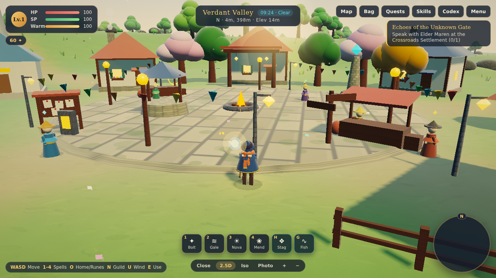
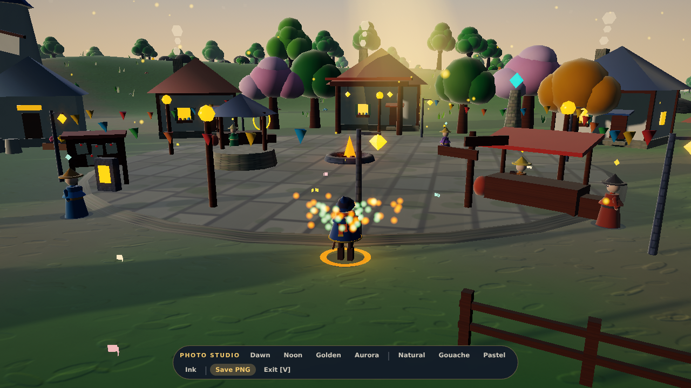
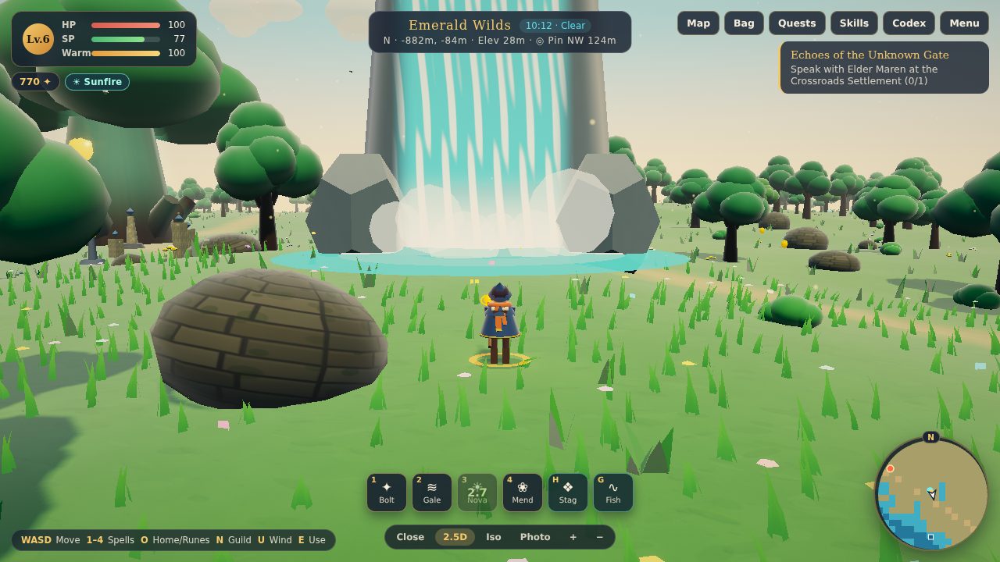
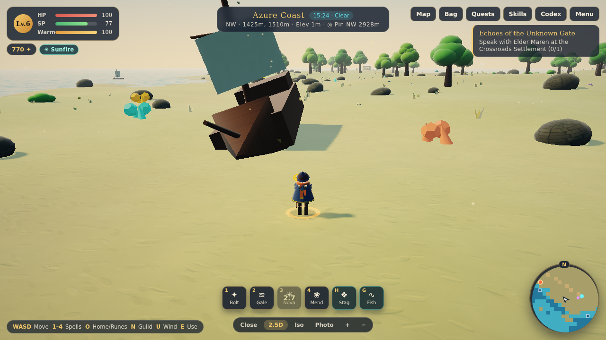
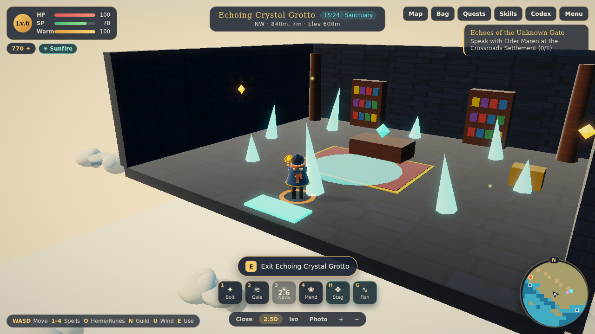

# THE UNKNOWN WORLD

A complete, original **2.5D Open-World Action-Exploration RPG** styled in **Anime Watercolor & Gouache 3D** (custom HDR Painterly Selective Bloom + OkLab Color Grade post-processing, cel-ink rim highlights, sRGB-calibrated gouache terrain & foliage, animated GLSL waterfalls, volumetric Fresnel sun-shafts, procedural painterly textures, and night Aurora Borealis), built with **Three.js (WebGL2)** and **Vite**.

## Live Gameplay Screenshots (Captured from Real WebGL2 Chromium)

| Crossroads Village (HDR Bloom & Gouache) | Golden Hour Photo Studio |
|---|---|
|  |  |

| Emerald Falls (Animated GLSL Waterfall) | Azure Coast Shipwreck & Coral Reefs |
|---|---|
|  |  |

| Sylph Wind Stag & Sunfire Nova | Subterranean Echoing Crystal Grotto |
|---|---|
|  |  |

## World & Core Features

- **Living Wind-Swaying 3D Meadow Grass, Sculpted Hero *Aelira*, Full Gamepad & Accessibility (Expansion IV)**:
  - **GPU-Instanced Meadow Grass & Wildflowers (`MeadowGrassSystem`)**: up to 4,200 3-blade organic grass tufts + 480 pastel wildflowers in 2 draw calls, recentering seamlessly around Aelira with rolling wind-wave animation, interactive footstep parting, biome color blending, and automatic clearing around cobblestone plazas, roads, sandy beaches, and waterfall plunge pools.
  - **Sculpted Protagonist *Aelira* & Crossroads Village Archway**: gold-trimmed cloak mantle & hem, twin articulated fluttering terracotta scarf ribbons, leather travel satchel with rolled parchment map scroll, timber Crossroads Welcome Archway with twin hanging glowing lanterns, and blooming pastel Sakura cherry-blossom trees.
  - **Full HTML5 Standard Gamepad Support (`GamepadControls`)**: plug-and-play Xbox / PlayStation / Switch Pro / Backbone mobile controller mapping (analog sticks, edge-triggered buttons, D-Pad Resonance Spells 1–4, `L3` Wind Stag, `R3` Guiding Wind, `LB` Shield/Parry, `RB` Heavy Strike, `Start`/`Select` menus) + live controller status in Settings.
  - **Accessibility Controls**: UI Scale (`90%`–`125%`), Reduced Camera Motion (disables screen shake), and High-Contrast HUD toggle.
- **AAA Painterly HDR Post-Processing & Adaptive GPU Profiler (Kong Royale-Inspired Engine Tech)**:
  - Custom zero-dependency WebGL2 `PostPipeline`: HDR HalfFloat scene target, quarter-res multi-radius **Selective Bloom** (glowing lanterns, Sunfire Nova, *Luma*, Waystones, Crystal Grotto spires, and Aurora), **OkLab Painterly Split-Tone & Bright-Green Gamut Roll-Off** (warm golden sunlit highlights, cool slate-indigo watercolor shadows, zero neon clipping), storybook vignette, and Interleaved Gradient Noise anti-banding dither (live toggle in Settings; bypassed on `Low` preset for 30+ FPS mobile).
  - Built-in rolling `FrameProfiler` & WebGL2 `detectHardwareProfile` for live FPS/frame-time telemetry and adaptive preset recommendations.
- **Biome Wonders & 10 Enterable 3D Interiors (7 Sanctuaries + 3 Subterranean Caves)**:
  - **2 Animated Custom GLSL Waterfalls**: *Emerald Falls* (Emerald Wilds) and *Silver-Crest Cascade* (Highland Reach) with flowing foam curtains, shimmering plunge pools, and rising mist puffs.
  - **Azure Coast Beached Shipwreck (*The Star-Seeker*) & Coral Reef Garden**: tilted weathered galleon hull with broken mast, billowing sail, stern lantern, salvageable Captain's Chest, and 16 sculpted coral reef clusters.
  - **Volumetric Fresnel Sun-Shaft God-Rays** & **Far-Horizon Landmark Beacons** across the 8×8 km world.
  - **10 Enterable 3D Interiors**: 7 regional sanctuaries (*Crossroads Elder's Hall*, *The Crystal Vault*, *The Drowned Archive Chamber*, *Heart Tree Root Hollow*, *Skywatch Astrolabe Sanctum*, *Silent Citadel Crypt*, *The Astral Spire Chamber*) **PLUS 3 Subterranean Caves** (*Echoing Crystal Grotto*, *Highland Ice Cavern*, *Whispering Frontier Cave*) framed by carved outdoor rock arches and glowing cave crystals.

- **Massive 8×8 km Playable Continent (inside a 15×15 km Expansion Architecture)**:
  - Seamless deterministic chunk streaming (`128 m` chunks, 3-tier LOD, zero loading screens) across **8 organic blended regions**: *Verdant Valley*, *Emerald Wilds*, *Highland Reach*, *Azure Coast*, *Forgotten Kingdom*, *Hollow Depths*, *Shattered Expanse*, and *Hidden Frontier*.
  - **8 Major Landmarks** with flat scenic pads, Stone Lore Tablets, and fast-travel Waystones — plus **4 Secondary Regional Outposts & Harbors** (*Tidehaven Harbor*, *Timberwatch Outpost*, *Frostcrest Basecamp*, *Ashen Caravan Camp*) and **4 Monumental Frontier Border Gates** (*Frostpeak Border Arch*, *Astral Rift Pier*, *Sunfire Sea Lighthouse*, *Whispering Mire Arch*).
  - **Rich Crossroads Village Hub**: cobblestone central plaza, sculpted wishing well fountain, glowing hearth campfire, wrought-iron street lanterns, merchant stalls, half-timbered cottages with warm windows, spinning gouache windmill, village oaks, and split-rail fences.
- **7 Enterable 3D Sanctuaries**:
  - Seamless doorway transitions (`E`) into lantern-lit 3D interior chambers with unique animated centerpieces, woven rugs, bookshelves, wall sconces, dedicated indoor 2.5D camera framing, lore charters, and treasure caches: *Crossroads Elder's Hall*, *The Crystal Vault*, *The Drowned Archive Chamber*, *Heart Tree Root Shrine*, *Skywatch Astrolabe Sanctum* (rotating brass orrery), *Citadel Throne Crypt*, and *Frostcrest Lodge*.
- **4-Spell Resonance Magic & Upgraded Action Combat**:
  - **4 Elemental Resonance Spells** (`1`–`4` or clickable HUD hotbar): **Resonance Bolt** (homing spirit orb), **Gale Updraft** (vertical lift + AoE gust into instant gliding), **Sunfire Nova** (fiery shockwave ring + burn DoT), and **Spirit Ward** (heal + golden absorption barrier).
  - **3-Hit Combo Finisher**, **Aerial Plunge Slam**, **Golden Perfect Parry** (`Right-Click` / `L` timed inside the 0.30 s parry window to stagger enemies for bonus counter damage), **Stealth Crouch (`Z`)** with `1.75×` Ambush Strikes, tactile hit-stop, camera shake, pooled 3D impact particles, floating damage popups, and **4 Multi-Phase World Bosses** with Phase II enrages & crimson Boss Health Bars (*Mossback Colossus*, *Glacier Sovereign*, *Elder Stone Warden*, and *Astral Leviathan*).
- **Mount, Fishing, Sailing, Diving, Spirit Familiar & Dynamic World Events**:
  - **Sylph the Wind Stag Mount (`H`)**: summonable glowing spirit stag with gallop speed, high leap, stamina sprint, and luminous cyan antlers.
  - **Interactive Spirit Fishing Mini-Game (`G`)**: cast into **6 shimmering coastal/river/cavern fishing spots** or straight from sailboats to catch **8 regional fish species** using a timing-zone reel bar.
  - **Sailing & Underwater Exploration**: board **3 interactive sailboats** moored in Azure Coast & Tidehaven Bay (`E`), swim, and **dive underwater (`C`/`Ctrl`)** with breath gauge & **5 sunken seabed treasures**.
  - **Spirit Familiar *Luma***: floating golden-cyan fairy orb orbiting Aelira that brightens at night & inside sanctuaries and pulses near hidden shrines, puzzles, and treasure caches.
  - **Living Dynamic World Events**: roving **Wandering Starlight Caravan** (rare rotating wares + live gold Map marker), **Nighttime Falling Starfalls** with collectible Starfall Shards, and **Guiding Spirit Wisps** leading to secret rewards.
- **Deep RPG Progression, Codex, Hearth Campfire & Endgame**:
  - **54 Items & 24 Recipes** (weapons, cloaks, boots, accessories, potions, camp meals, boss trophies, fish, and legendary endgame relics) with live 3D weapon & cloak visual tinting.
  - **3-Branch 18-Skill Mastery Tree (`P`)**: *Blade & Resonance*, *Wind & Wilds*, and *Arcane & Hearth* (unlockable tiers + passive stat scaling).
  - **Wayfarer's Codex (`B`)**: Bestiary for all **14 creatures** (incl. elemental weaknesses & kill counters), **24 Achievements** with XP/Sunshard rewards, **8 Ancient Lore Chronicles**, **4 Regional Factions** granting up to **-25% merchant trust discounts**, and overall **World Completion %**.
  - **Campfire Rest & Cooking Pot (`E` at hearths)**: pass time smoothly to Dawn / Midday / Dusk / Starlight, restore 100% HP/SP/Warmth, autosave, and cook hearty meals.
  - **18 Quests** chaining through regional story arcs into **Awakening the Unknown Gate** and the **Astral Leviathan** post-climax frontier challenge.
- **5 Timed Ancient Resonance Shrine Trials & Crossroads Guild Bounty Board (`[N]`)**:
  - **5 Timed Shrine Trials** across Verdant Valley, Emerald Wilds, Azure Coast, Highland Reach, and Shattered Expanse with glowing floating 3D golden Sky Rings, live HUD countdown timers, Bronze / Silver / Gold medals, and Sunshards/XP payouts.
  - **Crossroads Guild Bounty Board**: physical notice board in Crossroads Plaza (`E` or `[N]`) offering rotating Regional Contracts (Monster Hunts, Fishing, Shrine Trials, Elemental Reactions, Starfalls, Sanctuaries) that auto-track via EventBus and pay instant Sunshards, XP, and Regional Faction Trust.
- **Wayfarer's Homestead Sanctuary, Elemental Rune Anvil (`[O]`) & Elemental Combo Reactions**:
  - **Personal 3D Wayfarer's Cottage** overlooking Crossroads Settlement with **8 buildable 3D upgrades** (*Herb & Moonpetal Garden*, *Arcane Rune Anvil*, *Sylph Wind Stag Pavilion*, *Alchemist's Bench*, *Cartographer's Globe*, *Starlight Hearth* granting **Well-Rested +25 Max HP/SP**, *Spirit Lantern Porch*, and **Golden World Boss Trophy Pedestals** displaying trophies for all 4 World Bosses).
  - **4 Elemental Weapon Rune Infusions** (*Sunfire Ember*, *Frostbite Glacier*, *Tempest Gale*, *Astral Resonance*) adding glowing 3D weapon auras and triggering **3 Explosive Elemental Combo Reactions**: **2.2× THERMAL SHATTER** (Sunfire on Frosted foe), **1.8× WILDFIRE GALE** (Wind on Burning foe), and **2.0× ASTRAL OVERLOAD** (Resonance on Parried/Staggered foe).
- **Ghibli-Grade Visual Craftsmanship, Flat Runic Boss Arenas, Guiding Wind (`[U]`) & Photo Studio (`[V]`)**:
  - Sculpted articulated villagers with layered cloaks, sleeves, eyes & role props; cottages with shutters, blooming flower boxes & rising chimney smoke; festival plaza bunting; crossed-log hearth campfire; **4 Flat Runic World Boss Arenas** with glowing crystal obelisks; **Golden Guiding Wind (`[U]`)** directional breeze; and **Interactive Photo Studio (`[V]`)** with live Time-of-Day, Watercolor Filter presets (`Natural`, `Gouache`, `Pastel`, `Ink`), and one-click PNG postcard capture.
- **Studio-Grade Controls, Live Minimap, Map Pins & Performance Tuning**:
  - Live **Circular Watercolor Minimap**, interactive **World Map (`M`)** with fast travel, **Custom Compass Waypoint Pins**, and live **4 World Boss / Wandering Caravan / Active Starfall** markers; adjustable 2.5D camera presets (`Close`, `2.5D`, `Iso`, **`Photo` `[V]`**); 4 Graphics Presets (`Low`–`Ultra`) plus Render Scale, Shadow Override, FOV & Invert-Y controls; full desktop + mobile touch UI; adaptive 8-region Web Audio soundtrack & boss/spell/parry/splash SFX; and persistent multi-slot IndexedDB saves.

## Quick Start

```bash
npm install
npm run dev            # Start Vite dev server on http://0.0.0.0:5173
npm test               # Run all 25 automated Node unit & integration tests
npm run verify:browser # Run 19 real headless Chromium WebGL2 visual E2E checks
npm run build          # Build optimized production bundle to dist/
```

## Controls Reference

| Action | Desktop | Mobile / Touch |
|---|---|---|
| Move / Steer Sailboat / Ride Stag / Swim | `W A S D` / Arrow Keys | Left Virtual Joystick |
| Jump / Spirit Glider / Stag Leap | `Space` | Jump / Glide Button |
| Sprint / Gallop / Wall Climb | `Shift` | Sprint Toggle |
| Resonance Spells (Bolt / Gale / Nova / Mend) | `1` · `2` · `3` · `4` | Clickable HUD Spell Bar |
| Call / Dismiss Sylph Wind Stag | `H` | HUD `Stag` Slot |
| Spirit Fishing Cast & Reel | `G` | HUD `Fish` Slot / `Reel!` |
| Stealth Crouch (1.75× Ambush) | `Z` | Stealth Button |
| Dodge Roll / Underwater Dive | `C` or `Ctrl` | Dodge Button |
| Interact / Sail / Enter Sanctuary / Campfire / Trade | `E` | Contextual Action Prompt |
| Light / Combo / Heavy Staff Attack | Left Click / `J` (`Shift`+Click Heavy) | Strike / Heavy Buttons |
| Shield Guard / Golden Perfect Parry | Right Click / `L` | Shield Button |
| Rotate & Zoom 2.5D Camera | Right-Drag / Scroll / `Q X R F` | HUD Presets & Zoom |
| Photo Studio (Time / Filters / Save PNG) | `V` | HUD `Photo` Button |
| Guiding Wind Directional Breeze | `U` | — |
| Homestead & Rune Anvil · Guild Bounties | `O` · `N` | World Boards & Cottage |
| Map · Bag/Craft · Quests · Skills · Codex · Pause | `M` · `I` · `T` · `P` · `B` · `Esc` | Top-Right HUD Buttons |

## Project Structure

- `public/data/` — Data-driven JSON catalogs (`regions`, `items` + `recipes`, `quests`, `creatures`)
- `src/core/` — Engine loop, WebGL2 renderer & presets, scene lighting, asset loader, `Game` orchestrator
- `src/world/` — Deterministic terrain/biomes, chunk streaming, sculpted 3D vegetation, landmarks/outposts/frontier gates, boats/seabed treasures, 7 3D sanctuaries, Wind Stag mount, Spirit Fishing, Dynamic World Events, pooled 3D particles, watercolor shaders, water & weather/Aurora Borealis
- `src/player/`, `src/camera/`, `src/controls/` — Wayfarer movement/mounting/sailing/diving/stealth, live equipment tinting, adjustable 2.5D camera, keyboard/mouse & mobile touch input
- `src/gameplay/`, `src/entities/` — Inventory/Sunshards economy, crafting, 18 quests, 3-branch 18-skill progression, exploration, Resonance Magic, Wayfarer's Codex, combo/parry combat, 8 puzzles, 10 NPCs, wildlife, Spirit Familiar *Luma*, 14 creatures & 4 multi-phase bosses
- `src/ui/`, `src/save/`, `src/audio/` — 10 studio UI screens + spell hotbar, fishing bar & live minimap, IndexedDB persistence, adaptive Web Audio engine
- `tests/` — 7 Node `--test` suites (`16/16`) + 12-scene real headless Chromium WebGL2 visual verification (`tests/e2e-browser.mjs`)
- `docs/` — Architecture, GDD, Asset Manifest, Reverse-Engineering Notes & Verification Checklist
